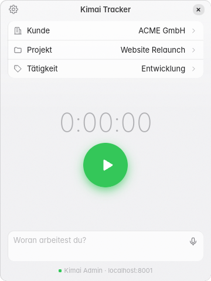
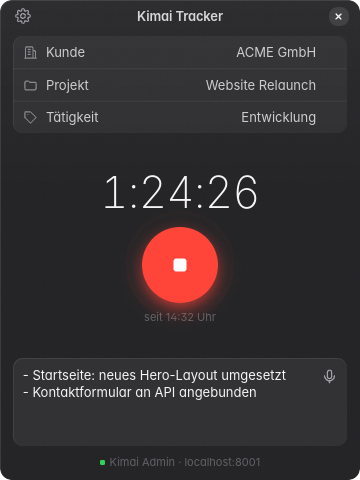

# Kimai Tracker

**Zeiterfassung für [Kimai](https://www.kimai.org) direkt auf dem Desktop:** Kunde, Projekt und
Tätigkeit wählen, Start drücken, fertig. Die Zeit läuft in deinem Kimai, die App ist nur der
schnellste Weg dorthin.

Entwickelt von **[Klein IT Solutions](https://klein-it.solutions)**. Für Einzelpersonen kostenlos,
für Teams und als Whitelabel-Lösung lizenzierbar, siehe [Lizenz](#lizenz).
 

| Hell | Dunkel |
| ---- | ------ |
|  |  |

## Was die App kann

- **Zeit erfassen mit einem Klick:** Kunde → Projekt → Tätigkeit auswählen und starten.
  Zuletzt genutzte Einträge stehen oben, die Listen sind durchsuchbar.
- **Immer synchron mit Kimai:** Ein Timer, den du im Browser gestartet hast, erscheint auch
  in der App und umgekehrt.
- **Beschreibung jederzeit ändern:** Was du während der Arbeit einträgst, wird automatisch in
  Kimai gespeichert.
- **Nachtragen und korrigieren:** Start vergessen oder lieber abends alles eintragen? Einträge
  lassen sich nachträglich anlegen, ändern und löschen, mit Diktat und KI-Stichpunkten.
- **Funktioniert auch offline:** Ist Kimai nicht erreichbar (Zug, Kunde ohne WLAN), läuft der
  Timer lokal weiter und neue Einträge werden auf deinem Rechner gespeichert. Sobald die
  Verbindung wieder da ist, überträgt die App alles automatisch an Kimai.
- **Läuft im Hintergrund:** Symbol im Infobereich mit laufender Zeit, Start/Stopp per
  Tastenkürzel, auf Wunsch Start bei der Anmeldung.
- **Spracheingabe:** Beschreibung einfach diktieren, wahlweise komplett offline auf deinem
  Rechner.
- **Stichpunkte per lokaler KI:** Macht aus Notizen und Diktaten kurze Stichpunkte, ohne dass
  Daten deinen Rechner verlassen.
- **Sicher:** Dein Kimai-Zugang liegt im Passwortspeicher des Systems, nicht in einer
  Textdatei.
- Helles und dunkles Design passend zum System, Fensterknöpfe passend zu Windows, GNOME,
  KDE und macOS.

## Download

Die aktuelle Version findest du unter
**[Releases](https://github.com/klein-it-solutions/kimai-desktop-app/releases/latest)**.

| System | Datei | Installation |
| ------ | ----- | ------------ |
| **Windows 10 / 11** | `…-windows-x64-setup.exe` | Doppelklick, keine Administratorrechte nötig |
| | `…-windows-x64-portable.exe` | Ohne Installation, einfach starten |
| **Ubuntu 24.04+, Debian 13+** | `kimai-tracker_…_amd64.deb` | Doppelklick oder `sudo apt install ./kimai-tracker_…_amd64.deb` |

Weitere Linux-Distributionen und macOS folgen später.

> **Windows-Hinweis:** Die App ist noch nicht digital signiert. Beim ersten Start zeigt Windows
> daher eventuell *„Der Computer wurde durch Windows geschützt“*. Klicke auf
> **Weitere Informationen → Trotzdem ausführen**.

## Einrichten in zwei Minuten

Du brauchst die Adresse deines Kimai und einen **API-Token**. Der Token ist ein persönlicher
Schlüssel, mit dem die App in deinem Namen Zeiten erfassen darf.

1. **Token in Kimai erstellen:** In Kimai anmelden → oben rechts auf dein Profilbild →
   **API-Zugang** → neuen Token anlegen (Name z. B. „Kimai Tracker“) → Token kopieren.
   Er wird nur einmal angezeigt.
2. **In der App eintragen:** Kimai Tracker öffnen → Zahnrad oben → bei *Server* die Adresse
   deines Kimai (z. B. `kimai.firma.de`) und bei *API-Token* den kopierten Token einfügen.
3. **Verbindung testen** und **Speichern** klicken. Unten im Fenster erscheint ein grüner
   Punkt mit deinem Namen.

Fehlt der Menüpunkt *API-Zugang*, muss dein Kimai-Administrator dir die Berechtigung dafür
geben.

## Bedienung

| Aktion | So geht's |
| ------ | --------- |
| Zeit starten | Kunde, Projekt und Tätigkeit wählen → grüner Knopf (oder **Strg + Enter**) |
| Zeit stoppen | Roter Knopf, Symbol im Infobereich oder **Strg + Enter** |
| Fenster zeigen/verstecken | Tastenkürzel: Windows **Strg + Alt + T**, Linux **Super + Umschalt + T** |
| Einträge ansehen, nachtragen, ändern | Listen-Symbol oben im Fenster |
| Startzeit des laufenden Timers ändern | Auf „seit … Uhr“ unter der Zeit klicken |
| Diktieren | Mikrofon-Knopf gedrückt halten und sprechen, oder einmal klicken zum Starten und nochmal zum Beenden |
| Diktieren, auch bei verstecktem Fenster | Windows **Strg + Alt + V**, Linux **Super + Umschalt + V** gedrückt halten |
| Beenden | Symbol im Infobereich → *Beenden* |

Das Schließen-Kreuz versteckt das Fenster nur, die App läuft im Infobereich weiter. Auch nach
dem Beenden läuft ein gestarteter Timer in Kimai weiter.

Tastenkürzel, Benachrichtigungen und *Beim Anmelden starten* stellst du in den Einstellungen
unter **Hintergrund** ein.

## Einträge nachtragen und ändern

Über das **Listen-Symbol** oben im Fenster siehst du alle Einträge eines Tages mit Tagessumme.
Mit den Pfeilen blätterst du zu früheren Tagen.

- **Nachtragen:** **Eintrag nachtragen** antippen, Kunde/Projekt/Tätigkeit und Zeit wählen,
  fertig. Die Startzeit schließt an den letzten Eintrag des Tages an, das Ende ist „jetzt“.
- **Ändern oder löschen:** Eintrag antippen.
- **Start vergessen?** Starte den Timer einfach jetzt und klicke unter der laufenden Zeit auf
  **„seit … Uhr“**. Dort trägst du ein, wann du wirklich angefangen hast.
- **Zeiten schnell tippen:** `9` wird zu 09:00, `930` zu 09:30, mit den Pfeiltasten gehst du
  in 5-Minuten-Schritten. **Strg + Enter** speichert.
- **Diktieren und ✨ Stichpunkte** funktionieren im Eintrag genauso wie beim Timer, auch wenn
  nebenher ein Timer läuft.

## Spracheingabe

Einstellungen → **Spracheingabe**. Du hast zwei Möglichkeiten:

- **Lokal (empfohlen):** Die Erkennung läuft komplett auf deinem Rechner, nichts wird
  hochgeladen. Lade einmalig ein Sprachmodell herunter:
  *Base* (57 MB, schnell), *Small* (181 MB, empfohlen für Deutsch) oder *Medium* (514 MB, am
  genauesten).
- **Online-Dienst:** Ein OpenAI-kompatibler Dienst (z. B. OpenAI oder Groq). Dafür brauchst du
  einen eigenen API-Schlüssel. Die Aufnahme wird an diesen Dienst gesendet.

Die Sprache richtet sich nach *Allgemein → Sprache* (Standard: Deutsch).

## Stichpunkte mit lokaler KI

Einstellungen → **Stichpunkte (lokale KI)** einschalten, dann bei *llama.cpp* (ca. 30 MB) und
bei einem Modell auf **Laden** klicken:

| Modell | Größe | Geeignet für |
| ------ | ----- | ------------ |
| Qwen2.5 0.5B | ca. 0,5 GB | sehr schnelle, einfache Stichpunkte |
| Qwen2.5 1.5B | ca. 1,1 GB | **empfohlen**, gutes Deutsch, wenige Sekunden auf einem Laptop |
| Llama 3.2 3B | ca. 2,0 GB | beste Formulierungen, braucht ca. 3 GB Arbeitsspeicher |

Danach erscheint neben dem Mikrofon ein ✨-Knopf. Er wandelt die Beschreibung in Stichpunkte
um, und mit *Rückgängig* holst du den alten Text zurück. Auf Wunsch werden Diktate
automatisch umgewandelt. Das Modell wird nur bei Bedarf geladen und nach fünf Minuten wieder
aus dem Speicher entfernt.

## Datenschutz

- Die App spricht nur mit **deinem Kimai-Server**. Es gibt keine Telemetrie und kein
  Benutzerkonto bei uns.
- Dein API-Token liegt im Passwortspeicher des Systems: Windows-Anmeldeinformationsverwaltung,
  GNOME-Schlüsselbund oder KWallet.
- Lokale Spracheingabe und KI-Stichpunkte arbeiten offline. Nur beim einmaligen Herunterladen
  der Modelle wird Hugging Face bzw. GitHub kontaktiert.
- Nur wenn du die Spracheingabe per Online-Dienst wählen, gehen Aufnahmen an diesen Dienst.

## Häufige Fragen

**„API-Token ungültig“ oder „Keine Berechtigung“?**
Erstelle in Kimai einen neuen Token und füge ihn erneut ein. Bei „Keine
Berechtigung“ fehlt deinem Kimai-Benutzer das Recht, die API zu nutzen oder eigene Zeiten zu
bearbeiten. Wende dich an deinen Kimai-Administrator.

**„Zertifikat nicht vertrauenswürdig“?**
Dein Kimai nutzt ein selbst ausgestelltes oder internes Zertifikat. Installiere das
Firmen-Stammzertifikat in deinem System oder frag deine IT.

**Unter Linux (GNOME) fehlt das Symbol im Infobereich.**
Aktiviere die Erweiterung *AppIndicator and KStatusNotifierItem Support*. Unter Ubuntu ist
sie vorinstalliert. Ohne Infobereich wird das Fenster beim Schließen minimiert statt versteckt.

**Das Tastenkürzel funktioniert nicht.**
Wird es schon von einem anderen Programm benutzt, sagen die Einstellungen das. Wähle dann
ein anderes Kürzel. Unter **Wayland** fragt dein Desktop beim ersten Mal nach einer
Bestätigung. Ältere Wayland-Desktops erlauben gar keine globalen Kürzel. Lege dann in den
Systemeinstellungen ein eigenes Tastenkürzel an, das `kimai-tracker --toggle` (Fenster) oder
`kimai-tracker --timer` (Start/Stopp) ausführt. Die Einstellungen zeigen den passenden Befehl
zum Kopieren an.

**Der Schlüsselbund ist nicht verfügbar (Linux).**
Die App bietet dann an, den Token in einer nur für dich lesbaren Datei zu speichern. Du kannst
ihn später in den Schlüsselbund verschieben.

**Wo finde ich die Version?**
Einstellungen → ganz unten unter *Info*.

**Wie deinstalliere ich die App?**
Windows: *Einstellungen → Apps → Kimai Tracker → Deinstallieren*. Ubuntu:
`sudo apt remove kimai-tracker`. Die Einstellungen bleiben erhalten.
Unter Windows liegen sie in `%APPDATA%\kimai-tracker`, unter Linux in
`~/.config/kimai-tracker`.

## Fehler melden und mitmachen

Fehler und Ideen bitte als [Issue](https://github.com/klein-it-solutions/kimai-desktop-app/issues)
melden, am besten mit Version und Betriebssystem. Sicherheitslücken bitte vertraulich melden,
siehe [SECURITY.md](SECURITY.md).

Entwickler finden Bauanleitung, Tests und Release-Ablauf in
[docs/development.md](docs/development.md) und [CONTRIBUTING.md](CONTRIBUTING.md).

## Lizenz

© Klein IT Solutions. Der Quellcode ist einsehbar, die Nutzung regelt die [Lizenz](LICENSE):

| | |
| --- | --- |
| **Kostenlos** | Eine einzelne Person nutzt die App privat oder beruflich, auch als Freelancer, mit unverändertem Branding. |
| **Kommerzielle Lizenz** | Einsatz in einem Team oder Unternehmen mit mehreren Nutzern, Whitelabel (eigenes Logo, eigener Name, geänderte Hinweise), Weitervertrieb oder Einbau in eigene Produkte. |

Für eine kommerzielle Lizenz melde dich über [klein-it.solutions](https://klein-it.solutions).

Enthaltene Komponenten Dritter und ihre Lizenzen stehen in
[THIRD_PARTY_NOTICES.md](THIRD_PARTY_NOTICES.md) und in der App unter *Einstellungen → Über → Lizenz*.
Version 0.0.1 wurde noch unter der MIT-Lizenz veröffentlicht.

Kimai Tracker ist ein unabhängiges Projekt und kein offizielles Produkt des Kimai-Projekts.

---

Mit KI entwickelt von <a href="https://klein-it.solutions">Klein IT Solutions</a>.
